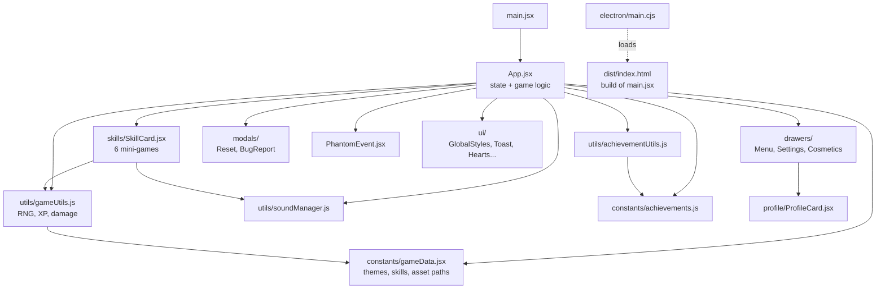

# Technical Debt Register

Living document. Every refactoring PR must reference an item below (`DEBT-xxx`),
and statuses must be kept up to date. New debt, including debt we introduce, is
added here as soon as it is discovered.

- **Version:** 0.1 (before any refactoring)
- **Team:** Benoit and Nicolas
- **Baseline commit:** `<commit-hash-of-first-push>` (fill in)
- **Last updated:** 2026-11-20

**Legend**

| Field | Values |
|---|---|
| Impact | 1 (cosmetic) to 5 (breaks the game or loses player data) |
| Likelihood | 1 (rare) to 5 (happens regularly or on every change) |
| Effort | S (under half a day), M (1 to 2 days), L (3+ days) |
| Priority | P0 (before any refactor), P1, P2, P3 |
| Status | `Open`, `In progress`, `Done`, `Won't fix` |

Items marked **(to verify)** come from reading the code and have not yet been
reproduced at runtime.

---

## 1. Map of the codebase

### 1.1 Modules and dependencies

### 1.2 Where the state lives

| State | Location | Persisted? |
|---|---|---|
| Skills per profile (level, XP, difficulty, current mobs, badges) | `App.jsx` `useState`, key `heroSkills_v23_p{1,2,3}` | `localStorage` |
| Active theme | inside the same save object (`theme`) | `localStorage` |
| Stats (achievements counters) | inside the same save object (`stats`) | `localStorage` |
| Current profile, profile names, parent status | `App.jsx`, keys `currentProfile_v1`, `heroProfileNames_v1`, `heroParentStatus_v1` | `localStorage` |
| Border effect and colour | `App.jsx`, keys `borderEffect_p{n}`, `borderColor_p{n}` | `localStorage` |
| Phantom event cooldown | `PhantomEvent.jsx` | `localStorage` |
| Volumes (music, SFX) | `App.jsx` + `soundManager.js` module-level variables | to verify |
| Battle state, challenge, mic state | `App.jsx` and `SkillCard.jsx` `useState` (about 60 hooks in total) | no |

### 1.3 Where the I/O happens

| I/O | Where | Notes |
|---|---|---|
| Persistence | `App.jsx` (27 `localStorage` calls), `PhantomEvent.jsx` (2) | Spread over many keys, no storage module |
| Audio | `soundManager.js`, `SkillCard.jsx` (6 `new Audio`) | Two places create audio directly |
| Speech recognition | `App.jsx` (`webkitSpeechRecognition`, 4 uses) | Documented in `docs/MICROPHONE_FEATURE.md` |
| Network | `index.css` (Google Fonts), `SkillCard.jsx` and `ProfileCard.jsx` (`transparenttextures.com`), `App.jsx` (`placehold.co` fallback) | No game API today. A trivia feature would be the first |
| Randomness | `gameUtils.js`, `SkillCard.jsx`, `App.jsx` (34 `Math.random` calls) | Not injectable |
| Time | `PhantomEvent.jsx`, `achievementUtils.js` (2 `Date.now`), plus 28 `setTimeout` | Not injectable |
| Fullscreen | `App.jsx` | Browser API called directly |
| Desktop shell | `electron/main.cjs` | Window creation only |

---

## 2. Baseline metrics

Captured **before any refactoring**. To reproduce, run each command from the
repository root.

### 2.1 File sizes (measured with `wc -l`)

| File | Lines |
|---|---|
| `src/App.jsx` | 1,492 |
| `src/components/ui/GlobalStyles.jsx` | 1,302 |
| `src/components/skills/SkillCard.jsx` | 778 |
| `src/constants/gameData.jsx` | 416 |
| `src/utils/gameUtils.js` | 363 |
| `src/components/drawers/CosmeticsDrawer.jsx` | 322 |
| `src/constants/achievements.js` | 318 |
| `src/utils/soundManager.js` | 287 |
| `src/components/drawers/MenuDrawer.jsx` | 262 |
| `src/components/drawers/MenuDrawer_old.jsx` | 231 |
| Total source (`src/` and `electron/`) | about 7,045 |

Other measures taken with `grep`:

| Measure | Value |
|---|---|
| Lines over 200 characters in `App.jsx` and `SkillCard.jsx` | 29 |
| `useState` calls (`App.jsx` / `SkillCard.jsx` / all `src`) | 31 / 16 / 60 |
| `useEffect` calls (all `src`) | 18 |
| `console.*` calls in `App.jsx` | 28 |
| `public/assets/` total size | about 242 MB (sounds about 201 MB, items 18 MB, mobs 18 MB) |

### 2.2 Metrics still to capture (fill in once `npm ci` works)

| Metric | Tool | Command | Baseline |
|---|---|---|---|
| Test coverage | Vitest + `@vitest/coverage-v8` | `npx vitest run --coverage` | 0% (no tests exist) |
| Cyclomatic complexity | ESLint `complexity` rule (or `plato`) | `npx eslint . --rule '{"complexity":["warn",10]}'` | TBD |
| Duplication | `jscpd` | `npx jscpd src --min-lines 5` | TBD |
| Lint errors | ESLint | `npm run lint` | TBD |
| Dependency graph | `madge` | `npx madge --image graph.svg src/App.jsx` | TBD |
| Startup time | Chrome DevTools, Lighthouse | Record Performance, note time to first interactive | TBD |
| Build size | Vite | `npm run build`, then note the `dist/` size | TBD |

---

## 3. Debt items

| ID | Location | Smell or issue | Impact | Risk (I × L) | Effort | Priority | Status |
|---|---|---|---|---|---|---|---|
| DEBT-001 | repo root, `package-lock.json`, `README.md` | Setup is undocumented and fragile (see details) | 3 | 3 × 5 = 15 | S | P0 | In progress |
| DEBT-002 | whole repo | No tests, no coverage, no safety net | 5 | 5 × 5 = 25 | M | P0 | Open |
| DEBT-003 | `.github/workflows/build-exe.yml` | CI only builds the `.exe`: no lint, tests, coverage or static analysis, and it releases on every push to `main` | 4 | 4 × 5 = 20 | M | P0 | Open |
| DEBT-004 | `App.jsx` (whole file) | God component: game logic, persistence, audio, speech and UI mixed (1,492 lines, about 31 `useState`) | 4 | 4 × 5 = 20 | L | P1 | Open |
| DEBT-005 | `SkillCard.jsx` | Six mini-games in one file with 600+ character inline handlers (math, writing) | 4 | 4 × 4 = 16 | L | P1 | Open |
| DEBT-006 | `App.jsx` (`loadSkills`, lines 49 to 240), `PhantomEvent.jsx` | Persistence is ad hoc: about 29 raw `localStorage` calls, many keys, repeated migration code (`heroSkills_v23`), parsing errors only logged | 5 | 5 × 3 = 15 | M | P1 | Open |
| DEBT-007 | `gameUtils.js`, `SkillCard.jsx`, `App.jsx` | Non-deterministic code: 34 `Math.random`, `Date.now`, and 28 `setTimeout` calls are not injectable, so tests would be flaky | 4 | 4 × 5 = 20 | M | P1 | Open |
| DEBT-008 | `App.jsx` (speech code) | Speech recognition tied to `webkitSpeechRecognition` and to the component. Unsupported browsers (to verify) get no clear fallback | 3 | 3 × 3 = 9 | M | P2 | Open |
| DEBT-009 | `constants/gameData.jsx` (`THEME_CONFIG`) | Themes reference files that do not exist: `kpop_memorycard.jpg`, `pokemon_memorycard.jpg`, `spy_memorycard.jpg`, `spy_logo.png` | 3 | 3 × 5 = 15 | S | P1 | Open |
| DEBT-010 | `constants/gameData.jsx` (`THEME_CONFIG.spy`) | The `spy` theme uses `minecraft.png` as its background | 2 | 2 × 5 = 10 | S | P2 | Open |
| DEBT-011 | `constants/gameData.jsx` | Themes only rename skills and bosses. Mobs, items, badges, sounds and mini-game images remain Minecraft-specific (`mobs: {}` for 3 of 4 themes). Hardcoded Minecraft names everywhere (`TNT`, `Netherite`, `Ender Dragon`...) | 3 | 3 × 5 = 15 | L | P2 | Open |
| DEBT-012 | `constants/gameData.jsx`, `constants/assets.js` | Asset paths duplicated across two files, and `assets.js` contains placeholder paths that don't exist | 2 | 2 × 3 = 6 | S | P3 | Open |
| DEBT-013 | `components/drawers/MenuDrawer_old.jsx` | Dead code (231 lines), not imported anywhere | 1 | 1 × 5 = 5 | S | P3 | Open |
| DEBT-014 | `components/modals/BugReportModal.jsx` | Stub: shows a message and does nothing | 3 | 3 × 5 = 15 | M | P2 | Open |
| DEBT-015 | `components/ui/GlobalStyles.jsx` | 1,302 lines of CSS inside JSX, mixed with Tailwind | 2 | 2 × 3 = 6 | M | P3 | Open |
| DEBT-016 | `public/assets/` | 242 MB of assets (201 MB of sound) with no loading strategy. Likely cause of the sluggish startup (to verify) | 4 | 4 × 5 = 20 | M | P1 | Open |
| DEBT-017 | `index.css`, `SkillCard.jsx`, `ProfileCard.jsx`, `App.jsx` | Runtime dependency on third-party hosts (Google Fonts, `transparenttextures.com`, `placehold.co`). Breaks offline and in the desktop app | 2 | 2 × 3 = 6 | S | P3 | Open |
| DEBT-018 | `App.jsx` (about 28 `console.*` calls, `catch` blocks at lines 167 to 236, 990, 1077) | Errors are logged and swallowed: failures are silent for the player and impossible to report | 3 | 3 × 4 = 12 | M | P2 | Open |
| DEBT-019 | `electron/main.cjs`, `package.json` | Desktop build is Windows-only with no way to check the packaged result in CI. Devtools disabled in production, which hides errors from support | 2 | 2 × 2 = 4 | S | P3 | Open |
| DEBT-020 | `index.html`, `package.json` | Default `<title>eliott-rpg-game</title>`, references `/vite.svg`, package name `eliott-rpg-game`, version `0.0.0` | 1 | 1 × 5 = 5 | S | P3 | Open |

### DEBT-001: Setup is undocumented and fragile

- **Found while:** launching the project for the first time.
- **Symptoms observed:**
  1. `ENOENT ... package.json`: the project sits in a `CodeWashGame/` subfolder of the repo, so npm run at the repo root found nothing.
  2. `vite: not found`: dependencies were not installed.
  3. `EUSAGE ... package-lock.json`: `npm ci` could not find the lock file.
- **Impact:** a newcomer loses time before reaching a running game, and `.github/workflows/` in a subfolder would be ignored by GitHub.
- **Plan:**
  1. Put the project at the repo root (`package.json` next to `.git`).
  2. Restore `package-lock.json` and commit it.
  3. Add `.gitignore` (`node_modules/`, `dist/`, `release/`).
  4. Add `README.md` with prerequisites, quick start and a troubleshooting table.
  5. Add an `engines` field to `package.json` stating the supported Node version.
  6. Optional: a `scripts/setup.sh` and `scripts/setup.ps1` that check the Node version and run `npm ci`.
- **Done when:** a newcomer goes from `git clone` to a running game in under 10 minutes without asking a question.

---

## 4. Risk matrix

Impact (rows) × likelihood (columns). Cells list debt IDs.

| Impact \ Likelihood | 1 | 2 | 3 | 4 | 5 |
|---|---|---|---|---|---|
| **5** | | | DEBT-006 | | DEBT-002 |
| **4** | | | | DEBT-005 | DEBT-003, DEBT-004, DEBT-007, DEBT-016 |
| **3** | | | DEBT-008 | DEBT-018 | DEBT-001, DEBT-009, DEBT-011, DEBT-014 |
| **2** | | DEBT-019 | DEBT-012, DEBT-015, DEBT-017 | | DEBT-010 |
| **1** | | | | | DEBT-013, DEBT-020 |

---

## 5. Phased attack plan

Order is driven by one rule: **we do not refactor what we cannot test.**

| Phase | Goal | Items | Owner | Why this order |
|---|---|---|---|---|
| **0. Get running** | Anyone can install, launch and test | DEBT-001, DEBT-020 | Benoit (001), Nicolas (020) | Nothing else is possible without a reproducible setup |
| **1. Safety net** | Tests, CI and gates before the first refactor is merged | DEBT-002, DEBT-003 | Benoit (002), Nicolas (003) | The subject requires it. The two items touch different files, so they run in parallel |
| **2. Make it testable** | Inject randomness and time, extract pure logic | DEBT-007, then DEBT-006, then DEBT-004 | Benoit | `App.jsx` has one owner at a time. Storage is the highest-risk data (player progress) |
| **3. Quick wins** | Remove dead code, fix broken assets | DEBT-013, DEBT-009, DEBT-010, DEBT-012 | Nicolas | Low effort, no `App.jsx` edits, makes the Themes work simpler |
| **4. Split the monoliths** | One module per mini-game, slimmer `App.jsx` | DEBT-005, DEBT-015, DEBT-008 | Nicolas (after Benoit's DEBT-004 is merged for 008) | Safe once logic is covered by tests. `SkillCard.jsx` is separate from `App.jsx`, so 005 can start in phase 2 |
| **5. Features** | Deliver the 4 chosen missions | See section 6.3 | Split by feature | Each feature closes debt items on its way |
| **6. Handover** | Measure again, update this register, write ADRs, changelog and runbook | all | Both | The register becomes the map of the residual debt |

Re-measure the metrics in section 2 after each phase and record the
before/after numbers in section 7.

---

## 6. Team organisation

### 6.1 Working agreement

- **Branches:** one per debt item, named `debt-007-inject-random`. Never push to `main`.
- **Pull requests:** one PR per debt item. The PR description names the item it closes (`Closes DEBT-007`) and links the GitHub issue.
- **Review:** the other person reviews and approves every PR. Nobody merges their own work without review.
- **CI is the referee:** no merge on red. If a gate has to be lowered or bypassed, that is new debt: add an item here with the reason.
- **Register upkeep:** the PR author updates Status, the assignments table and any metric in the **same PR**, so this file never drifts from the code.
- **Conflict avoidance:** `App.jsx` (about 1,500 lines, touched by DEBT-004, 006, 007, 008, 018) has **one owner at a time**. Say in the team chat before starting work in it, and merge small PRs quickly.
- **Re-scoring:** impact and likelihood changes are agreed by both of us and noted in the change log.
- **Sync:** short check-in at the start of each work session to say what is in progress.

### 6.2 Assignments

| ID | Owner | Reviewer | Issue | PR | Branch | Status |
|---|---|---|---|---|---|---|
| DEBT-001 | Benoit | Nicolas | | | | In progress |
| DEBT-002 | Benoit | Nicolas | | | | Open |
| DEBT-003 | Nicolas | Benoit | | | | Open |
| DEBT-004 | Benoit | Nicolas | | | | Open |
| DEBT-005 | Nicolas | Benoit | | | | Open |
| DEBT-006 | Benoit | Nicolas | | | | Open |
| DEBT-007 | Benoit | Nicolas | | | | Open |
| DEBT-008 | Nicolas | Benoit | | | | Open |
| DEBT-009 | Nicolas | Benoit | | | | Open |
| DEBT-010 | Nicolas | Benoit | | | | Open |
| DEBT-011 | Nicolas | Benoit | | | | Open |
| DEBT-012 | Nicolas | Benoit | | | | Open |
| DEBT-013 | Nicolas | Benoit | | | | Open |
| DEBT-014 | Benoit | Nicolas | | | | Open |
| DEBT-015 | Nicolas | Benoit | | | | Open |
| DEBT-016 | Benoit | Nicolas | | | | Open |
| DEBT-017 | Benoit | Nicolas | | | | Open |
| DEBT-018 | Benoit | Nicolas | | | | Open |
| DEBT-019 | Nicolas | Benoit | | | | Open |
| DEBT-020 | Nicolas | Benoit | | | | Open |

Where two items touch the same file, the owner who works on it second waits
for the first PR to merge. In particular, DEBT-007 also edits `SkillCard.jsx`
(5 `Math.random` calls): Benoit does that part, then Nicolas starts DEBT-005.

### 6.3 Feature missions (to be decided together)

We must pick 4 of: Performance, Bug Reporting, Translation, Themes, New Game,
New Game+ (New Game+ requires New Game). This is a **proposal**, not a decision.

| Mission | Proposed owner | Debt items it closes or relies on |
|---|---|---|
| Performance | Benoit | DEBT-016, DEBT-017 |
| Bug Reporting | Benoit | DEBT-014, DEBT-018 |
| Themes | Nicolas | DEBT-009, DEBT-010, DEBT-011, DEBT-012 |
| Translation | Nicolas | DEBT-011 (centralised strings) |

### 6.4 Open questions and decisions

| Date | Question | Decision | Who |
|---|---|---|---|
| | Final choice of the 4 missions | pending | Benoit, Nicolas |
| | Test runner and CI tooling (Vitest, ESLint, which static analyser) | pending | Benoit, Nicolas |
| | Where the project lives in the repo (root vs subfolder) | pending | Benoit, Nicolas |

---

## 7. Change log of this register

| Date | Change | Author |
|---|---|---|
| 2026-11-20 | First version: codebase map, 20 debt items, baseline file-size measures, risk matrix attack plan, owners and reviewers per item, working agreement, feature proposal, decisions log | Benoit, Nicolas |
| | | |

### Before / after metrics (to complete)

| Metric | Baseline | After phase 1 | After phase 2 | After phase 4 | Final |
|---|---|---|---|---|---|
| Test coverage | 0% | | | | |
| `App.jsx` lines | 1,492 | | | | |
| `SkillCard.jsx` lines | 778 | | | | |
| Max cyclomatic complexity | TBD | | | | |
| Duplicated lines (%) | TBD | | | | |
| Startup time | TBD | | | | |
